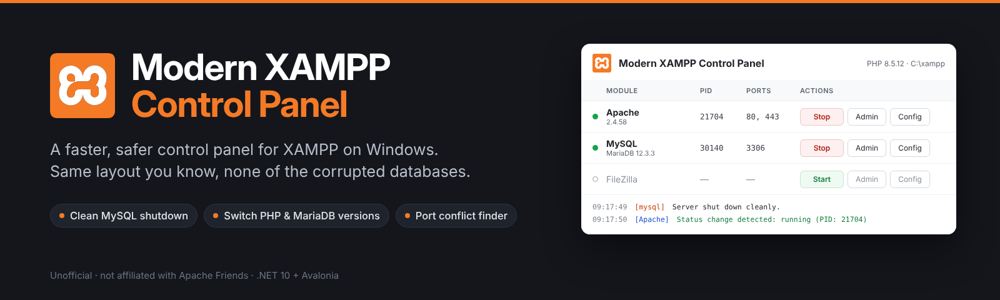

<p align="center">
  
</p>

<p align="center">
  <a href="https://github.com/ClearanceClarence-Software/Modern-XAMPP-Control-Panel/releases/latest"></a>
  <a href="https://github.com/ClearanceClarence-Software/Modern-XAMPP-Control-Panel/releases"></a>
  
  
  <a href="LICENSE"></a>
</p>

A drop-in replacement for the XAMPP Control Panel on Windows. It keeps the layout you already know
(module rows, Start/Stop, Admin, Config, Logs) and fixes the things that hurt: databases corrupted
by hard kills, cryptic "shutdown unexpectedly" errors, and no way to change PHP or MariaDB versions.

> [!NOTE]
> This is an unofficial, community project. It is not affiliated with or endorsed by Apache Friends.
> XAMPP and the XAMPP logo are trademarks of Apache Friends.

<!--
Screenshots: add them to docs/assets/ and remove this comment.
<p align="center">
  
  
</p>
-->

## Why use it

| | XAMPP Control Panel | Modern XAMPP Control Panel |
|---|---|---|
| Stopping MySQL/MariaDB | Ends the process | Clean shutdown with `mariadb-admin`, so InnoDB flushes its logs |
| When a server won't start | "Shutdown unexpectedly" | Shows the last lines of the error log in the panel |
| Ports in use | Generic warning | Names the program and PID holding the port, before starting |
| PHP / MariaDB versions | Whatever came with XAMPP | Install, update and switch between several versions |
| Versions at a glance | No | Apache, PHP and MariaDB versions read from the binaries |
| Look and feel | 2010s VCL | Modern UI, same familiar layout |

## Features

**Familiar control panel.** Module rows for Apache, MySQL, FileZilla, Mercury and Tomcat with
Service, PID(s), Port(s), Start/Stop, Admin, Config and Logs, plus Config, Netstat, Shell, Explorer,
Services and Help buttons, just like the original.

**Safe MySQL/MariaDB handling.** Stop always tries a clean shutdown first. A hard kill is only
offered as **Force stop** when the clean shutdown fails, and it tells you that InnoDB will run crash
recovery on the next start.

**Startup failures explained.** If Apache or MySQL exits right after starting, the panel shows the
last lines of `error.log` or `mysql_error.log`, so you see *why* without opening files.

**Port conflict finder.** Before a module starts (and optionally when the panel opens), the panel
checks its ports and reports exactly which program holds them:
`Port 80 in use by "C:\Program Files\Skype\Skype.exe" with PID 4120!`

**PHP and MariaDB versions.** The **Versions** window lists every installed build and lets you:

- **Install** a new version straight from windows.php.net or downloads.mariadb.org (SHA-256
  verified), or from a zip you downloaded yourself.
- **Switch** between installed versions in seconds; the server is stopped and restarted for you.
- **Switch back** after any install or switch, and **remove** versions you no longer need.

**Netstat.** Listening TCP sockets with address, port, PID and process, refreshed every 3 seconds.
New sockets show in green, closed ones in dark red, and XAMPP's own processes are marked.

**XAMPP-style configuration.** Editor, browser, XAMPP folder, autostart per module, start
minimized, port check on startup, debug output, plus Service and Port Settings, User Defined Files
and Log Options.

## Download

1. Download `ModernXamppControlPanel-<version>-win-x64.zip` from the
   [latest release](https://github.com/ClearanceClarence-Software/Modern-XAMPP-Control-Panel/releases/latest).
2. Unzip `XamppControl.exe` anywhere, for example next to `xampp-control.exe` in `C:\xampp`.
3. Run it. It finds XAMPP in its own folder, the folder above it, or `C:\xampp`, and asks for the
   folder if none of those has an install.

It's a single self-contained exe: no installer and no .NET runtime to install.

> [!TIP]
> Windows SmartScreen may warn about an unrecognized app the first time. Choose
> **More info › Run anyway**.

### Requirements

- Windows 10 or 11, x64
- XAMPP for Windows (any recent version)

## How versions work

The active build always lives where XAMPP expects it (`C:\xampp\php` and `C:\xampp\mysql`), so
Apache's config and `my.ini` keep working. Other builds are kept in `C:\xampp\versions\php\<version>`
and `C:\xampp\versions\mariadb\<version>`, and switching swaps the folders.

**PHP.** Only PHP 8 Thread Safe x64 builds are supported, because XAMPP runs PHP as an Apache
module. A new version carries over your `php.ini`, PEAR and XAMPP's extras. Extensions the new build
doesn't include are commented out in `php.ini` and listed in the log. On every install or switch,
the DLLs PHP shares with Apache (OpenSSL, libssh2, nghttp2, …) are synced, using the newer copy of
each, so `php_curl` and `mod_ssl` both load.

**MariaDB.** Each version keeps **its own databases**. They can't share one data folder: a newer
server converts the data files so older servers can't open them. Installing a newer version:

1. optionally saves an SQL dump of all databases to `C:\xampp\mysql_dumps`,
2. does a full clean shutdown (`innodb_fast_shutdown=0`),
3. copies the data folder, `my.ini`, scripts and batch files into the new version,
4. starts it and runs `mariadb-upgrade`, repairing Aria system tables if needed.

The previous version stays installed with its own untouched copy, so switching back gives you the
exact state from before the update. Downgrades are refused.

## Settings and files

| What | Where |
|---|---|
| Settings | `%AppData%\XamppControl\settings.json` |
| Optional log file | `%AppData%\XamppControl\xampp-control.log` |
| Downloads | `%TEMP%\XamppControl` |
| Installed versions | `C:\xampp\versions\` |
| SQL dumps | `C:\xampp\mysql_dumps\` |

The MySQL root password (Config › Service and Port Settings) is only used for clean shutdowns,
dumps and upgrades. It is stored in plain text in `settings.json`, which is fine for a local
development machine but worth knowing.

## Troubleshooting

**MySQL won't stop cleanly.** Set the root password under Config › Service and Port Settings. If
the server really is stuck, use **Force stop**.

**A module runs as a Windows service.** Updates and version switches need the module to run
normally. Untick its Service checkbox first (this asks for admin rights).

**Apache won't start after a PHP change.** The panel shows the reason from `error.log`. Use
**Switch back** in the Versions window to return to the previous PHP.

## Building from source

Requirements: the [.NET 10 SDK](https://dotnet.microsoft.com/download/dotnet/10.0).

```powershell
git clone https://github.com/ClearanceClarence-Software/Modern-XAMPP-Control-Panel.git
cd Modern-XAMPP-Control-Panel
dotnet run
```

Self-contained single-file build, as published in releases:

```powershell
dotnet publish -p:PublishProfile=win-x64
# bin\publish\win-x64\XamppControl.exe
```

Pushing a tag like `v0.2.0` builds the exe with GitHub Actions and publishes it as a release.

## Contributing

Issues and pull requests are welcome. The code style is defined in `.editorconfig` (Allman braces,
120 columns, `_camelCase` private fields, analyzers at `latest-recommended`). Before opening a pull
request, run:

```powershell
dotnet format --verify-no-changes
dotnet build
```

and make sure neither reports anything.

## License

[MIT](LICENSE) © ClearanceClarence.

XAMPP and the XAMPP logo are trademarks of [Apache Friends](https://www.apachefriends.org/).
Apache, MariaDB, MySQL and PHP are trademarks of their respective owners.
