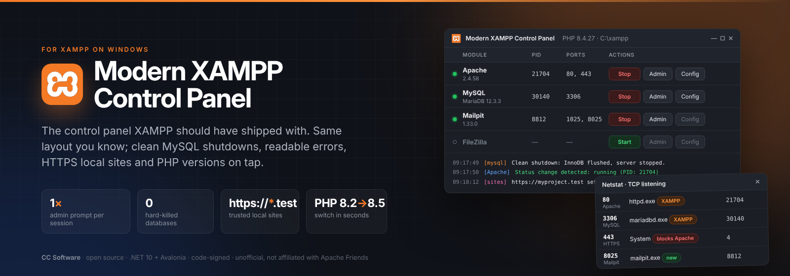
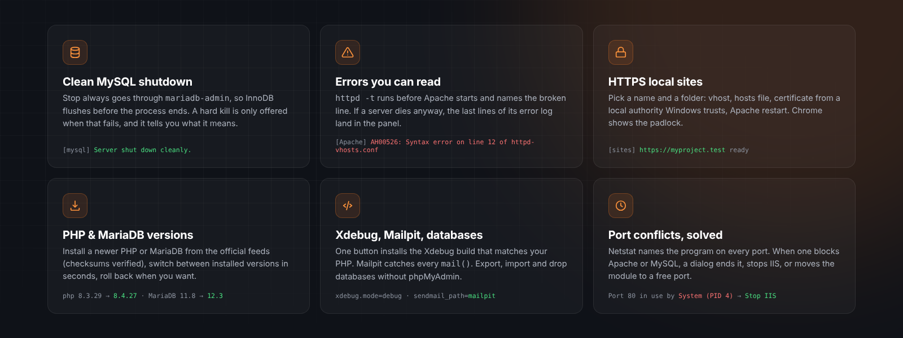

<p align="center">
  
</p>

<p align="center">
  <a href="https://github.com/ClearanceClarence-Software/Modern-XAMPP-Control-Panel/releases/latest"></a>
  <a href="https://github.com/ClearanceClarence-Software/Modern-XAMPP-Control-Panel/releases"></a>
  <a href="https://github.com/ClearanceClarence-Software/Modern-XAMPP-Control-Panel/actions/workflows/ci.yml"></a>
  
  
  
  <a href="LICENSE"></a>
</p>

<p align="center">
  <a href="https://github.com/ClearanceClarence-Software/Modern-XAMPP-Control-Panel/releases/latest"><b>Download for Windows</b></a>
  &nbsp;·&nbsp;
  <a href="#features">Features</a>
  &nbsp;·&nbsp;
  <a href="#quick-start">Quick start</a>
  &nbsp;·&nbsp;
  <a href="#how-versions-work">How versions work</a>
  &nbsp;·&nbsp;
  <a href="#troubleshooting">Troubleshooting</a>
  &nbsp;·&nbsp;
  <a href="CHANGELOG.md">Changelog</a>
</p>

<br>

**Modern XAMPP Control Panel** is a drop-in replacement for the control panel that ships with XAMPP
on Windows. It keeps the layout you already know (module rows, Start/Stop, Admin, Config, Logs) and
fixes the things that hurt: databases corrupted by hard kills, cryptic "shutdown unexpectedly"
errors, ports taken by something you can't see, and no way to change PHP or MariaDB versions.

One signed, self-contained `.exe`. No installer, no runtime to install, nothing moved in your XAMPP
folder that you didn't ask for.

> [!NOTE]
> This is an unofficial, community project by [CC Software](https://github.com/ClearanceClarence-Software).
> It is not affiliated with or endorsed by Apache Friends. XAMPP and the XAMPP logo are trademarks of
> Apache Friends.

<br>

<p align="center">
  
</p>

## Why switch

| | XAMPP Control Panel | Modern XAMPP Control Panel |
|---|---|---|
| Stopping MySQL/MariaDB | Ends the process | Clean shutdown with `mariadb-admin`, so InnoDB flushes its logs |
| When a server won't start | "Shutdown unexpectedly" | `httpd -t` runs first; otherwise the last lines of the error log show in the panel |
| Ports in use | Generic warning | Names the program and PID, then offers to end it, stop IIS, or move the module |
| PHP / MariaDB versions | Whatever came with XAMPP | Install, update, switch and roll back, from the official feeds |
| Local sites | Edit `httpd-vhosts.conf` and the hosts file by hand | `https://myproject.test` in one click, with a certificate Windows trusts |
| php.ini | Open it in Notepad | Common settings, every extension, and Xdebug with one button |
| Mail from PHP | Goes nowhere, or everywhere | Mailpit catches it at `localhost:8025` |
| Databases | phpMyAdmin | Export, import and drop from the panel |
| Admin prompts | Every service action | Once per session |
| Look and feel | 2010s VCL, one theme | Light and dark, tray icon, same familiar layout |

## Quick start

1. Download `ModernXamppControlPanel-<version>-win-x64.zip` from the
   [latest release](https://github.com/ClearanceClarence-Software/Modern-XAMPP-Control-Panel/releases/latest).
2. Unzip `XamppControl.exe` anywhere, for example next to `xampp-control.exe` in `C:\xampp`.
3. Run it. It finds XAMPP in its own folder, the folder above it, or `C:\xampp`, and asks for the
   folder if none of those has an install.

**Requirements:** Windows 10 or 11 (x64) and XAMPP for Windows, any recent version. The original
control panel keeps working; the two can be used side by side.

> [!TIP]
> Windows SmartScreen may warn about an unrecognized app the first time. Choose
> **More info › Run anyway**. Releases are signed with a Certum code-signing certificate; each
> release's notes name the signer, and [docs/code-signing.md](docs/code-signing.md) shows how to
> check the signature.

## Features

<details open>
<summary><b>The panel</b></summary>
<br>

- **Familiar layout.** Module rows for Apache, MySQL, FileZilla, Mercury, Tomcat and Mailpit with
  Service, PID(s), Port(s), Start/Stop, Admin, Config and Logs, plus Config, Netstat, Versions,
  Databases, Logs, Sites, PHP, Shell, Explorer, Services and Help buttons.
- **Light and dark themes.** Follows Windows by default; the sun/moon button in the header switches.
- **Tray icon.** Shows what runs, starts and stops modules from its menu, keeps the panel out of
  the taskbar when minimized.
- **One admin prompt per session.** Service actions and the hosts file reuse a single elevation.
- **Quit asks.** Closing with Apache or MySQL running offers a clean stop or leaving them running.
- **Update notice** in the header with the release notes of every version since yours.
- **Crash reports.** An unrecoverable error shows a window with the details and a button to open
  an issue; the report is also saved to `crash.log`.
</details>

<details open>
<summary><b>Safe servers</b></summary>
<br>

- **Clean MySQL/MariaDB shutdown.** Stop always tries `mariadb-admin shutdown` first. A hard kill is
  only offered as **Force stop** when that fails, and it tells you InnoDB will run crash recovery.
- **Startup failures explained.** `httpd -t` runs before Apache starts and names the broken line.
  If Apache or MySQL exits right after starting, the last lines of `error.log` or `mysql_error.log`
  appear in the panel.
- **Port conflicts found and fixed.** Before a module starts, the panel names the program and PID
  holding each port. A dialog offers to end that program, stop IIS when Windows itself holds the
  port, or move Apache to 8080/4433 (MySQL to 3307) with the config files and settings updated.
- **Netstat.** Every listening socket with what the port is for (Apache, MySQL, HTTP, Remote
  Desktop…), who can reach it, and a warning when a foreign program blocks a stopped module. Filter,
  sort, pause, and Open / Folder / Copy / End per row.
- **Logs window.** Follows Apache, PHP and MariaDB logs live, like `tail -f`, with a filter.
</details>

<details open>
<summary><b>Development tools</b></summary>
<br>

- **Sites with HTTPS.** Give each project its own address, such as `https://myproject.test`. Apply
  writes the virtual hosts to a marked block in `httpd-vhosts.conf`, tests the config, adds the
  names to the hosts file, issues a certificate from a local authority Windows trusts, and restarts
  Apache. `localhost` keeps serving `htdocs`. Each site has Editor and Terminal buttons.
- **PHP settings.** The values everyone changes (memory limit, upload size, time limits, display
  errors, time zone) and every extension in `php\ext` with a check box. The previous file is kept
  as `php.ini.bak`.
- **Xdebug with one button.** Installs the build that matches your PHP (version, thread safety,
  compiler) from PECL, turns it on in debug mode on port 9003, and off again when you want speed.
- **Mail catcher.** Installs [Mailpit](https://github.com/axllent/mailpit) and points `mail()` at
  it. Every message shows at `http://localhost:8025` instead of leaving your computer.
- **Databases.** List with sizes, export to a timestamped `.sql` (routines, events and triggers
  included), import into a new or existing database, drop.
</details>

<details open>
<summary><b>Versions</b></summary>
<br>

- **PHP and MariaDB.** Install a new version straight from windows.php.net or
  downloads.mariadb.org (SHA-256 verified) or from a zip, switch between installed versions in
  seconds, switch back after any install or switch, remove what you no longer need.
- **FileZilla Server.** XAMPP still ships FileZilla Server 0.9.41 from 2012. The Versions window
  runs the official 1.x installer you downloaded and the FileZilla row then controls the new
  server. (1.x can't read 0.9's settings, so FTP users are set up again in its Admin program.)
- **XAMPP-style configuration.** Editor, browser, XAMPP folder, autostart per module, start
  minimized, minimize to tray, update check, port check on startup, debug output, Service and Port
  Settings, User Defined Files and Log Options.
</details>

## How versions work

The active build always lives where XAMPP expects it (`C:\xampp\php` and `C:\xampp\mysql`), so
Apache's config and `my.ini` keep working. Other builds are kept in `C:\xampp\versions\php\<version>`
and `C:\xampp\versions\mariadb\<version>`, and switching swaps the folders.

**PHP.** Only PHP 8 Thread Safe x64 builds are supported, because XAMPP runs PHP as an Apache
module. A new version carries over your `php.ini`, PEAR and XAMPP's extras. Extensions the new build
doesn't include are commented out in `php.ini` and listed in the log. On every install or switch,
the DLLs PHP shares with Apache (OpenSSL, libssh2, nghttp2, …) are synced, using the newer copy of
each, so `php_curl` and `mod_ssl` both load.

**MariaDB.** Each version keeps **its own databases**. They can't share one data folder: a newer
server converts the data files so older servers can't open them. Installing a newer version:

1. optionally saves an SQL dump of all databases to `C:\xampp\mysql_dumps`,
2. does a full clean shutdown (`innodb_fast_shutdown=0`),
3. copies the data folder, `my.ini`, scripts and batch files into the new version,
4. starts it and runs `mariadb-upgrade`, repairing Aria system tables if needed.

The previous version stays installed with its own untouched copy, so switching back gives you the
exact state from before the update. Downgrades are refused.

## Settings and files

| What | Where |
|---|---|
| Settings | `%AppData%\XamppControl\settings.json` |
| Optional log file | `%AppData%\XamppControl\xampp-control.log` |
| Crash reports | `%AppData%\XamppControl\crash.log` |
| Local certificate authority | `%AppData%\XamppControl\local-ca.pfx` (private) and `local-ca.crt` (public) |
| Site certificate | `C:\xampp\apache\conf\ssl.crt\modern-xampp-local.crt` and `ssl.key\modern-xampp-local.key` |
| Downloads | `%TEMP%\XamppControl` |
| Installed versions | `C:\xampp\versions\` |
| SQL dumps | `C:\xampp\mysql_dumps\` |
| Mailpit | `C:\xampp\mailpit\` (exe, `mailpit.db`, `mailpit.log`) |

The local certificate authority's private key (`local-ca.pfx`) can sign certificates your browser
trusts, the same way mkcert works. It never leaves your computer, but keep it private, and remove
"Modern XAMPP Control Panel Local CA" from Windows' certificate manager (`certmgr.msc`, Trusted Root
Certification Authorities) if you stop using the panel.

The MySQL root password (Config › Service and Port Settings) is only used for clean shutdowns,
dumps, the Databases window and upgrades. It is stored in plain text in `settings.json`, which is
fine for a local development machine but worth knowing.

## Troubleshooting

<details>
<summary><b>MySQL won't stop cleanly</b></summary>
Set the root password under Config › Service and Port Settings. If the server really is stuck, use <b>Force stop</b>.
</details>

<details>
<summary><b>A module runs as a Windows service</b></summary>
Updates and version switches need the module to run normally. Untick its Service checkbox first (this asks for admin rights).
</details>

<details>
<summary><b>A site shows "Not secure"</b></summary>
Click <b>Trust</b> in the Sites window and answer Yes to Windows' warning. Firefox keeps its own certificate list: import <code>local-ca.crt</code> there, or set <code>security.enterprise_roots.enabled</code> to <code>true</code> in <code>about:config</code>.
</details>

<details>
<summary><b>A site name doesn't resolve</b></summary>
The hosts file is only changed after the admin prompt. If you canceled it, or an antivirus blocked the change, click <b>Apply</b> again.
</details>

<details>
<summary><b>Apache won't start after a PHP change</b></summary>
The panel shows the reason from <code>error.log</code>. Use <b>Switch back</b> in the Versions window to return to the previous PHP.
</details>

<details>
<summary><b>Xdebug install says PECL has no build</b></summary>
PECL builds each Xdebug release per PHP branch and compiler; a brand-new PHP may have to wait a release. Try again after the next Xdebug version, or install an older PHP branch from the Versions window.
</details>

<details>
<summary><b>Mail from PHP still doesn't show in Mailpit</b></summary>
Check that the Mailpit row is running and that <code>php.ini</code> has <code>sendmail_path</code> pointing at <code>mailpit.exe sendmail</code> (the install sets it; Apache must restart afterwards). Code that uses its own SMTP settings (PHPMailer, Laravel) should point at <code>127.0.0.1:1025</code>.
</details>

## Building from source

Requirements: the [.NET 10 SDK](https://dotnet.microsoft.com/download/dotnet/10.0).

```powershell
git clone https://github.com/ClearanceClarence-Software/Modern-XAMPP-Control-Panel.git
cd Modern-XAMPP-Control-Panel
dotnet run --project XamppControl.csproj
```

Self-contained single-file build, as published in releases:

```powershell
dotnet publish XamppControl.csproj -p:PublishProfile=win-x64
# bin\publish\win-x64\XamppControl.exe
```

Releases are built, signed with a Certum code-signing certificate and uploaded as a draft on the
maintainer's PC with `tools/release.ps1`; GitHub Actions checks that each push formats, builds and
passes the tests. See [docs/code-signing.md](docs/code-signing.md) and [docs/testing.md](docs/testing.md).

## Contributing

Issues and pull requests are welcome; the issue forms ask for the log, which usually shows the
cause. The code style is defined in `.editorconfig` (Allman braces, 120 columns, `_camelCase` private
fields, analyzers at `latest-recommended`) and explained, with examples, in
[CODING_STANDARDS.md](CODING_STANDARDS.md). Before opening a pull request, run:

```powershell
dotnet format XamppControl.slnx --verify-no-changes
dotnet build XamppControl.slnx
dotnet test XamppControl.slnx
```

and make sure none of them reports anything. The tests in `tests/` cover the parsers (release feeds,
`php.ini`, virtual hosts, the hosts file, port rewriting); add one when you change those.

## Security

Please report security problems privately through the repository's **Security** tab, not in a public
issue. [SECURITY.md](SECURITY.md) says what counts and what to include.

## License

[MIT](LICENSE) © ClearanceClarence / CC Software.

XAMPP and the XAMPP logo are trademarks of [Apache Friends](https://www.apachefriends.org/).
Apache, MariaDB, MySQL, PHP, Xdebug and Mailpit are trademarks or projects of their respective owners.

<p align="center">
  <sub>Built with <a href="https://avaloniaui.net/">Avalonia</a> and .NET 10 · Made in Skien, Norway</sub>
</p>
